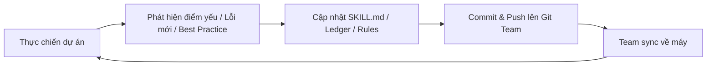

# AI Skills & Engineering Standards Hub

> **Single Source of Truth (SSOT)** lưu trữ, quản lý và liên tục tiến hóa các năng lực (Skills) và tiêu chuẩn kỹ thuật (Rules) cho đội ngũ AI Agent khi làm việc cùng team phát triển phần mềm.

---

## 🎯 1. Mục đích ra đời của Project này

Trong kỷ nguyên Pair-Programming với AI, một AI Agent không có ngữ cảnh dự án và quy chuẩn chung sẽ dễ:
- Viết code thừa, lặp lại các hàm đã có trong hệ thống (duplication).
- Làm mất dữ liệu hoặc sửa ngoài phạm vi cho phép (destructive risk).
- Để lộ dấu vết AI, làm bẩn lịch sử Git (watermarks, non-standard commits).
- Lặp lại cùng một lỗi sai mà lập trình viên đã từng nhắc nhở nhiều lần.
- Đốt quota vào các model đắt tiền cho các tác vụ đơn giản, hoặc dùng model quá yếu cho bài toán kiến trúc phức tạp.

**Thư mục dự án này được tạo ra nhằm:**
1. **Chuẩn hóa tri thức & văn hóa kỹ thuật của Team vào AI**: Đảm bảo mọi AI Agent (dù chạy trên máy của bất kỳ thành viên nào trong team) đều tuân thủ chung một tư duy kỹ thuật, phong cách code và quy chuẩn an toàn.
2. **Kho phân phối tập trung**: Cung cấp cơ chế phân phối 1 chạm (`sync.ps1`) giúp các thành viên mới hay cũ đều sở hữu cùng một bộ công cụ hỗ trợ tốt nhất.
3. **Bảo tồn và kế thừa kinh nghiệm thực chiến**: Biến các bài học xương máu (qua bug, sự cố production, sửa đổi kiến trúc) thành các file Skill & Ledger tồn tại vĩnh viễn, giúp AI ngày càng thông minh hơn qua từng dự án.

---

## 📂 2. Cấu trúc và Chức năng của các Thành phần

```text
Skills/
├── skills/                      # Năng lực tác vụ theo quy trình (Executable Runbooks)
│   ├── codegraph/               # Giao thức tư duy kiểm tra symbol, callers, blast radius
│   ├── git-clean-workflow/      # Quy chuẩn Git chuyên nghiệp, ẩn danh tính AI 100%
│   ├── mistake-memory/          # Sổ tay lỗi lặp (Ledger) tự học & checklist phòng ngừa
│   ├── multi-model-orchestration/ # Bộ định tuyến tác vụ thông minh qua 7 mô hình AI
│   ├── orimise-deep-planning/   # Quy trình uỷ quyền giải quyết bug khó qua Orimise API
│   ├── playwright/              # Kỹ năng tự động hóa kiểm thử E2E và browser
│   └── project-charter/         # Khởi tạo dự án: phỏng vấn → AGENTS.md → chọn skill (đa agent)
├── rules/                       # Luật cứng bắt buộc (Always-on Behavioral Constraints)
│   ├── codegraph-intelligence.md       # Cấm duplicate code, soi code cục bộ
│   ├── destructive-operations-safety.md# Chặn xóa tệp/thư mục tùy tiện
│   ├── git-author-clean-code.md        # Chuẩn hóa danh tính & commit
│   ├── multi-model-orchestration.md    # Phân loại độ phức tạp công việc
│   ├── multi_model_escalation.md       # Cơ chế leo thang model thông minh
│   ├── orimise-model-routing.md        # Giới hạn an toàn token & chi phí
│   ├── plan-approval-first.md          # Luật lập plan và chờ duyệt trước khi code
│   ├── project-charter.md              # Bắt buộc có Project Charter trước khi code
│   └── project-initialization.md       # Tự động dựng khung .agents/ khi vào dự án mới
├── sync.ps1                     # Script đồng bộ 1 chạm (Global hoặc theo Project)
└── README.md                    # Tài liệu hướng dẫn sử dụng nhanh
```

---

## 🚀 3. Cam kết Hoàn thiện & Cải tiến Liên tục (Continuous Evolution)

Dự án này **không phải là tài liệu tĩnh**, mà là một **hệ thống tri thức sống (living knowledge system)** được bạn và team liên tục kiểm nghiệm, tinh chỉnh và nâng cấp:



### 🔁 Các trục cải tiến cốt lõi của Team:

1. **Nâng cao độ chính xác (Precision & Zero-Hallucination)**:
   - Thử nghiệm các prompt/giao thức tư duy mới (như *Surgical Inspection*, *Descriptive Phrasing*).
   - Tối ưu hóa hướng dẫn từng bước để loại bỏ hoàn toàn các phán đoán mơ hồ của AI.
2. **Mở rộng phạm vi Mistake Ledger**:
   - Khi phát sinh bất kỳ lỗi coding mới nào (về async, database transaction, encoding, UI component...), ghi nhận ngay vào [`mistake-memory/ledger.md`](file:///e:/Program%20Files/AI%20Skills/Skills/skills/mistake-memory/ledger.md).
   - Biến lỗi của 1 người thành bài học phòng ngừa tự động cho toàn bộ các thành viên còn lại.
3. **Tối ưu hóa Chi phí & Tốc độ (Token & Cost Efficiency)**:
   - Liên tục đánh giá năng lực của các dòng mô hình AI mới ra mắt (Gemini 3.x, Claude Sonnet 4.x/Opus, GPT-OSS...).
   - Cập nhật bảng routing để đảm bảo chỉ dùng tài nguyên cao cấp khi thực sự cần thiết.
4. **Bổ sung các Skill chuyên biệt cho Tech Stack của Team**:
   - Mở rộng thêm các skill mới theo nhu cầu thực tế: Docker deployment, CI/CD pipelines, Performance profiling, Security audit...

---

## 👥 4. Nguyên tắc Cộng tác & Đóng góp (Contribution Culture)

Để repository luôn giữ được chất lượng cao nhất, mọi thành viên trong team tuân thủ các nguyên tắc:

* **Thử nghiệm trước khi commit**: Mọi thay đổi trong `SKILL.md` hoặc `rules/` cần được chạy thử thực tế với ít nhất 1-2 prompt thực tế để đo lường độ hiểu lệnh của Agent.
* **Nguyên tắc Progressive Disclosure**: Giữ file `SKILL.md` ngắn gọn, súc tích. Các tài liệu hướng dẫn chuyên sâu nên đặt trong thư mục con `references/`.
* **Không lưu trữ Secret/Credentials**: Tuyệt đối không commit API key, token hay mật khẩu vào repo (đã được cấu hình trong `.gitignore`).
* **Pull & Sync thường xuyên**: Mỗi sáng trước khi bắt đầu công việc, kéo mã mới từ Git và chạy `.\sync.ps1 -Target global` để luôn làm việc với phiên bản AI Agent mạnh mẽ nhất.

---

> [!TIP]
> **Khẩu hiệu của Team:** *"Mỗi lần AI làm sai là một cơ hội cập nhật Skill để không bao giờ lặp lại sai lầm đó lần thứ hai."*
