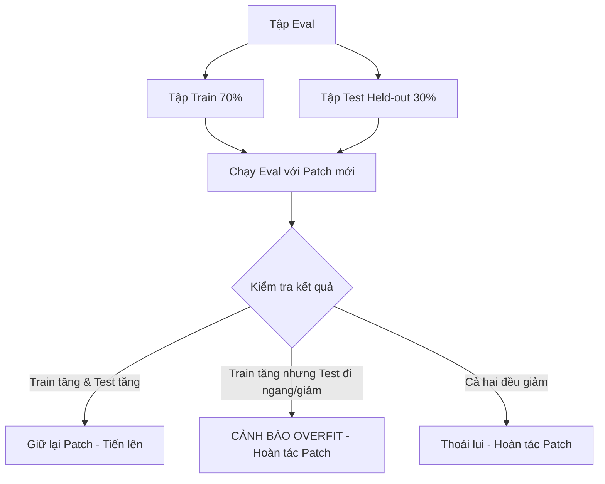

# Thiết Kế Evals & Thuật Toán Hillclimbing Tối Ưu Hóa Agent

Tài liệu này đúc kết phương pháp luận xây dựng hệ thống đánh giá (Evaluations) và chu trình leo đồi (Hillclimbing) để tối ưu hóa prompt, kỹ năng và agent harness mà không rơi vào bẫy học vẹt (overfitting).

---

## 1. 4 Trụ Cột Thiết Kế Evals Chuẩn Production

Một bộ đánh giá (Eval Suite) đáng tin cậy phải thỏa mãn 4 tiêu chí cốt lõi:

1. **Nhiệm vụ phản ánh đúng thực tế (Mirror Production)**:
   - Dữ liệu đánh giá phải được trích xuất từ các tác vụ thực tế trong môi trường sản xuất (transcript người dùng, vé báo lỗi, pull request thực), không phải các bài toán đồ chơi tự tạo để dễ chấm điểm.
2. **Hiệu năng tỷ lệ thuận với năng lực mô hình & effort**:
   - Khi chuyển sang model thông minh hơn (Haiku $\rightarrow$ Sonnet $\rightarrow$ Opus) hoặc nâng mức effort (low $\rightarrow$ high), điểm chuẩn phải tăng lên rõ rệt. Nếu điểm không tăng, nguyên nhân thường do đề bài quá mập mờ hoặc bộ chấm điểm (grader) bị lệch chuẩn.
3. **Có dư địa phát triển (Headroom at the Frontier)**:
   - Mô hình mạnh nhất ở mức effort cao nhất không được đạt điểm 100% tuyệt đối (thường nằm trong khoảng $70\% - 85\%$). Nếu điểm đã đạt $\ge 95\%$, bộ eval đã bão hòa và không còn khả năng đo lường các cải tiến mới.
4. **Độ biến thiên giữa các lần chạy thấp (Low Run-to-Run Variance)**:
   - Hai lần chạy trên cùng một phiên bản code phải cho ra kết quả tương đồng. Cần dọn dẹp sạch môi trường sau mỗi lần chạy (xóa file rác, reset git tree) để tránh việc lần chạy sau vô tình "nhìn trộm" đáp án của lần chạy trước.

---

## 2. Các Dạng Grader & Xác Thực Bộ Chấm Điểm

Bộ chấm điểm (Grader) quyết định tính trung thực của toàn bộ hệ thống eval:

| Dạng Grader | Khi Nào Sử Dụng | Cách Thức Hoạt Động |
|---|---|---|
| **Programmatic Verification (Chấm bằng mã)** | Đầu ra có cấu trúc chặt chẽ (JSON, exit code, test pass/fail) | Chạy test suite, kiểm tra JSON Schema, đối chiếu regex. Rẻ nhất, nhanh nhất và $100\%$ khách quan. |
| **LLM-as-a-Judge (Mô hình làm trọng tài)** | Đầu ra dạng ngôn ngữ tự nhiên, code phức tạp | Dùng một mô hình độc lập (khác mô hình đang được test) đọc output và chấm điểm dựa trên một bản **Rubric các mệnh đề kiểm chứng được** (Checkable claims), không dùng thang điểm chung chung 1-5. |
| **Pairwise Blind Comparison (Đối đầu mù)** | So sánh phiên bản mới với phiên bản gốc (Baseline) | Trọng tài nhận hai câu trả lời A và B được tráo ngẫu nhiên (không biết câu nào là baseline) và chọn ra câu trả lời tốt hơn kèm lập luận. |

---

## 3. Quy Trình Snapshot Baseline Trước Khi Hillclimb

Trước khi thực hiện bất kỳ vòng tối ưu hóa nào, **bắt buộc phải ghi nhận bản ghi Baseline Eval**:

```json
{
  "eval_id": "eval_skill_audit_v1",
  "timestamp": "2026-10-07T23:00:00Z",
  "model": "claude-sonnet-4-6",
  "effort": "med",
  "prompt_hash": "a1b2c3d4...",
  "total_cases": 40,
  "train_cases": 28,
  "test_cases": 12,
  "baseline_train_score": 0.714,
  "baseline_test_score": 0.667,
  "confidence_interval": "±0.045"
}
```

---

## 4. Chu Trình Tối Ưu Hóa Hillclimbing Chống Overfit



### 3 Nguyên Tắc Chống Học Vẹt (Overfitting) Bắt Buộc:
1. **Chia tách Tập Train và Tập Test Chuẩn 70/30 (Held-out Split)**:
   - Tỷ lệ phân chia khuyến nghị chuẩn là **70% Tập Huấn Luyện (Train Set)** và **30% Tập Kiểm Thử Độc Lập (Test Set)**.
   - Quá trình phân tích lỗi và hillclimbing chỉ được phép đọc các transcript và lỗi phát sinh trong tập Train (70%).
   - Tập Test (30%) tuyệt đối được giữ kín để làm thước đo khách quan. Nếu điểm Train tăng mà điểm Test không đổi hoặc giảm $\rightarrow$ Agent đang học vẹt các ca cụ thể $\rightarrow$ **Revert ngay lập tức**.
2. **Tuyệt đối không dán transcript lỗi vào prompt**:
   - Không được copy-paste câu trả lời sai của mô hình vào prompt để dặn "lần sau đừng làm thế này". Điều này làm phình context và tạo ra các quy tắc chắp vá cục bộ. Phải sửa ở nguyên nhân gốc rễ (Root Cause).
3. **Phản biện khi điểm số bị chững lại (Reflection Step)**:
   - Khi điểm số không tăng sau 2 vòng lặp liên tiếp: dừng chỉnh sửa. Gom toàn bộ các ca lỗi còn lại và phân loại theo nhóm nguyên nhân (Content gap, Grader flaw, hay Model reasoning limit). Thường có khoảng $10-20\%$ số ca lỗi xuất phát từ việc Grader hiểu sai tài liệu!
